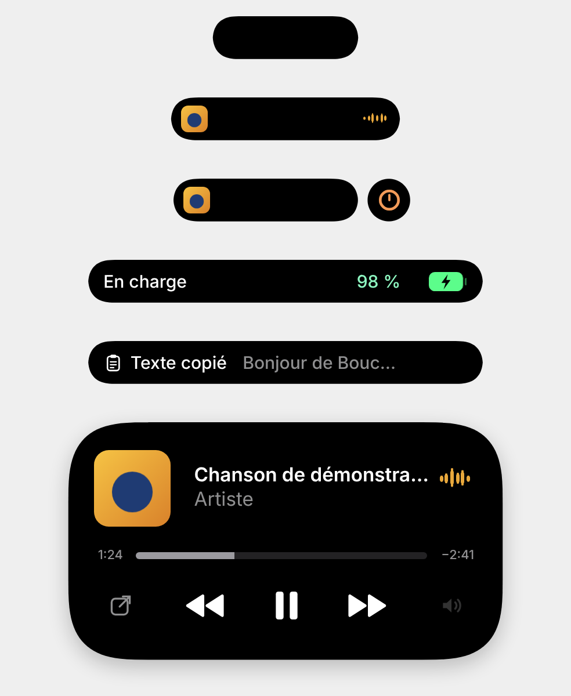

# Dynamic Island pour Windows

Réplique fidèle du Dynamic Island de l'iPhone, en overlay en haut au centre de l'écran Windows.
Toutes les tailles, courbes de coins, ressorts et délais ont été **mesurés** sur des enregistrements
d'écran d'un iPhone 16 Pro (iOS 27) — voir [`docs/mesures.md`](docs/mesures.md) — puis **validés** :
écart < 3 % sur les 10 transitions comparées, contenu à ±1 image ([`docs/fidelite.md`](docs/fidelite.md)).



## Ce que fait l'île

| Situation | Affichage |
|---|---|
| Rien en cours | Pilule noire au repos |
| Musique (Spotify, navigateurs, Apple Music…) | Compact : pochette + onde à la couleur de la pochette. **Appui long** : lecteur complet (titre, artiste, barre de progression déplaçable, précédent / lecture-pause / suivant, ouvrir l'app, changer de source). **Clic court** : ouvre l'app qui joue |
| Minuteur | Compact : icône + temps restant ; étendu : pause / annuler + compte à rebours |
| Musique + minuteur | Mode **split** : île + bulle (effet goutte) |
| Chargeur branché / débranché, batterie faible (20 %, 10 %), volume, Ne pas déranger, notifications, **presse-papiers**, fin du minuteur | Alerte (forme mesurée sur « En charge 98 % ») puis retour automatique |
| Caméra / micro utilisés | Point **vert** (caméra, avec ou sans micro) ou **orange** (micro seul), comme sur iPhone |

Chorégraphie iOS reproduite : rétraction avant un changement d'activité, « bosse » verticale et bulle
qui sort du bord droit en mode split (île décalée de 17 pt vers la gauche, comme sur iPhone), gonflement
à l'appui long, rebond au clic, la bulle qui se refond puis se détache, contenu qui apparaît flou puis net.

## Installer (Windows 11)

**Le plus simple** : sur GitHub, onglet **Actions** → workflow **Windows** → dernier passage → artefact
`installateur-windows` (`.msi` ou `.exe`).

**Depuis le code** (Node.js LTS, Rust, Visual Studio Build Tools « C++ », Python 3) :

```bash
npm install
```

```bash
npm run tauri build
```

L'installateur est dans `src-tauri/target/release/bundle/`.

## Utiliser

- **Icône dans la zone de notification** : Réglages, choix de l'écran, Démarrer avec Windows, Cacher en
  plein écran, Quitter.
- **Taille de l'île** : menu de l'icône (Petite, Normale, Grande, Très grande) ou curseur dans le panneau.
  Mémorisée au redémarrage ; les proportions restent exactes.
- **Ctrl + Alt + D** : ouvre / ferme le panneau de réglages — boutons pour tester chaque animation (une fois
  ou en boucle), un curseur par valeur de `island.config.ts` (appliqué en direct), bouton **Exporter** (JSON).
- **Arrêter le test** : gros bouton rouge du panneau, menu de l'icône, ou simplement **fermer le panneau** :
  l'île efface les activités de test et revient à ce qui se passe vraiment sur le PC.
- **Clic** sur l'île : petit rebond (et ouverture de l'app qui joue) ; **appui long** : vue étendue.
- **Minuteur** depuis un raccourci, un MacroPad ou un Stream Deck :

```bash
dynamic-island.exe --minuteur 5m
```

  (`90s`, `1h30m`, `2m30s`, `300` ; aussi `--minuteur-pause`, `--minuteur-reprendre`, `--minuteur-annuler`).
- Toutes les échelles Windows sont prises en charge (100 %, 125 %, 150 %, 200 %…), écran par écran.

## Développer

```bash
npm run tauri dev
```

Journal : dans le terminal (backend) ; console de la page avec `$env:ILE_DEVTOOLS=1` avant la commande.

**Essayer l'île sans Windows** (navigateur, données factices) :

```bash
npm run dev
```

Puis ouvrir `http://localhost:1420/?demo` et, dans la console : `__ile.jouer("musique")`,
`__ile.jouer("etendre")`, `__ile.jouer("minuteur")`, `__ile.jouer("charge")`…

| Dossier | Contenu |
|---|---|
| `src/island.config.ts` | **Seul** fichier de valeurs visuelles (toutes mesurées, sources en commentaire) |
| `src/rendu/` | Rendu : forme squircle, chorégraphie, contenus, icônes originales |
| `src/state/islandMachine.ts` | Machine à états (repos, compact, split, étendu, alerte) |
| `src/panneau/` | Panneau de réglages |
| `src-tauri/src/` | Backend Rust : fenêtre, média, système, minuteur, démarrage, icône de notification |
| `tools/` | Mesure (vidéos, captures), enregistrement de notre île, validation de fidélité |
| `docs/` | `mesures.md`, `fidelite.md`, `limites.md`, `instructions.md` |

## Tests

```bash
npm test
```

```bash
cd src-tauri && cargo test
```

```bash
tools\.venv\Scripts\python -m pytest tools/tests
```

## Refaire les mesures et la validation

```bash
python tools/mesurer_reference.py
```

```bash
npx vite --port 1420
```

```bash
node tools/enregistrer_ile.cjs
```

```bash
python tools/valider_fidelite.py
```

Vidéos de référence à placer dans `tools/input/` (ignoré par git).

## Police et images

Police **Inter** (licence OFL). Aucune icône ni aucun asset Apple : les icônes sont des formes simples
dessinées pour ce projet (`src/rendu/icones.tsx`).
