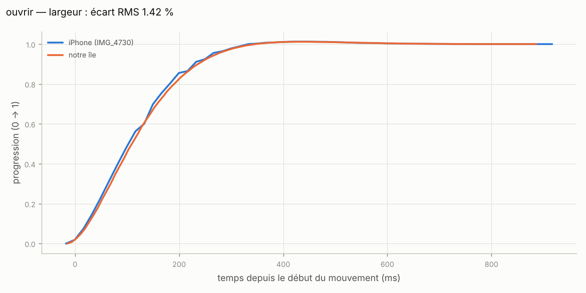

<div align="center">

# Dynamic Island for Windows

### The most realistic Dynamic Island on Windows.

**Not "inspired by" — measured.** Every size, corner curve, spring and delay was measured frame by frame
on screen recordings of a real iPhone 16 Pro (iOS 27), then checked against it: **less than 3 % difference**
on every animation compared.

[](https://github.com/Mede2026/Dynamic-island-for-windows-real/releases/latest)
[](https://github.com/Mede2026/Dynamic-island-for-windows-real/actions/workflows/windows.yml)


[](LICENSE)


[**Download**](https://github.com/Mede2026/Dynamic-island-for-windows-real/releases/latest) · [Features](#-what-it-does) · [Why it's the most realistic](#-why-its-the-most-realistic) · [En français](#-en-français)

</div>

---

## ✨ What it does

The island sits at the top-center of your screen, like on an iPhone, and reacts to what's actually happening on your PC. **More than 40 things**, grouped below.

### 🎵 Music
- Album art + a waveform that **moves with the real sound**, tinted with the cover's color.
- **Long press** → full player: title, artist, draggable progress bar, previous / play-pause / next.
- 🎤 **Live lyrics** under the camera, line by line (LRCLIB).
- 🎶 **What's this song?** (Ctrl + Alt + S): listens to your PC for a few seconds and shows the cover, title and artist.

### ⏱️ Activities
- **Timers** (also from the Windows Clock app, the pinned icon, a link or `--minuteur 5m`), with **split mode**: the island + a bubble that detaches like a drop.
- 📞 **Calls** (Teams, Discord, Zoom, WhatsApp…): duration, **mute your mic**; **incoming call** card with Answer / Decline.
- 📲 **Your phone** through *Phone Link*: calls and texts in the island.
- ⬇️ **Downloads** in progress, then **Open**. 🖨️ **Printing**: page 2/4, then *Printed* (or *Out of paper*).
- 🔴 **Screen recording**: red dot and duration.

### 🔔 Alerts
- 🔋 Charger, battery 20 % / 10 %, **battery saver** (yellow). 🔊 Volume and ☀️ brightness — **replacing Windows' own popups**.
- 📋 Clipboard, 📸 screenshot **thumbnail**, 🔔 notifications (title, app, message) with a **Copy code** button for verification codes.
- 🎧 Bluetooth devices (with battery), audio output switched, 🎙️ mic muted, 🔌 USB drive, 🖥️ external screen, 🗂️ virtual desktop, 🔠 Caps Lock / Num Lock.
- 📶 Internet lost / back, Wi-Fi weak, 🌙 Do Not Disturb, 🖥️ Windows Update restart, 🔓 **unlock padlock**.
- 🟢🟠 **Camera / microphone dot** — same rule as iOS.

### 🧰 Tools (right-click the island) — they open **inside the island**, no windows
- 📂 **Shelf**: drag files onto the island to keep them at hand; open, copy, paste in Explorer.
- 📋 **Recently copied** (Ctrl + Alt + V): the last 10 texts, kept in memory only — click to paste.
- 🔍 **Search, Mac-style** (Ctrl + Alt + Space): the island becomes a glass pill with a results card — apps, your files, Windows Settings, calculator & converter, Wikipedia, web. Type a question to **ask Claude** (your API key, Settings → Claude).
- ↕️ Pull the **handle** under any tool card to make it bigger.
- 🌀 **Asus Fan Control**: temperature, fan speed, profiles and battery limit, live in the island.
- ⏱️ **Quick timer** (Ctrl + Alt + M) and 📝 **Note** (Ctrl + Alt + N).
- 📸 **Screenshots** show up large in the island, shaped like your capture.
- 🕒 **Clock** when the mouse passes over the idle island; 👁️ break reminders (20-20-20).

### 🪟 Built into Windows
- **Right-click its pinned icon** for ready-made timers; `dynamicisland://` links; a Windows notification with **Repeat** when a timer ends.
- Updates itself: the island tells you when a new version is out and installs it in one click.
- Every display scale (100 % → 200 %+), any monitor, starts with Windows, can hide in fullscreen and from screen sharing.

And the little things you only notice on a real iPhone: nothing is ever drawn where the camera would be, the island **shrinks before changing activity**, gets a **vertical bump** before splitting, **bounces** when tapped, and content **fades in from a blur** with the measured delays. Prefer a Mac look? There's a **notch mode** too. Want a clean screen? **Hidden mode** keeps the island out of sight until an alert comes in.

## 🎯 Why it's the most realistic

Most Dynamic Island clones are drawn by eye. This one was **reverse-engineered from video**:

1. **Recorded** the real island on an iPhone 16 Pro (iOS 27): music, timer, split, alerts, opening, closing.
2. **Measured** each frame with Python + OpenCV, with sub-pixel edge detection (edges found to a fraction of a pixel).
3. **Fitted** each animation to a spring model (the physics iOS uses) to get its exact *response* and *damping* (how fast it moves and how much it bounces).
4. **Measured the corners**: they're not simple circles but **superellipses** (a smoother, "squircle" curve), so they were fitted too.
5. **Recorded our own island** frame by frame and **compared** it to the iPhone curve.

**Result: 10 transitions compared, between 0.6 % and 2.5 % difference (RMS = average gap), content timing within ±1 frame.**



<sub>Blue: real iPhone. Orange: this app. Every source and number is in [`docs/mesures.md`](docs/mesures.md) and [`docs/fidelite.md`](docs/fidelite.md).</sub>

## 📥 Install

1. Go to the [**latest release**](https://github.com/Mede2026/Dynamic-island-for-windows-real/releases/latest).
2. Download **`Dynamic.Island_…_x64-setup.exe`** and run it.
3. Launch **Dynamic Island** from the Start menu. It can **start with Windows** (tray icon menu).

> Windows SmartScreen may warn you because the app isn't signed (a paid certificate): click **More info → Run anyway**.

Works at every Windows display scale (100 %, 125 %, 150 %, 200 %…) and on any monitor you choose.

> The interface is in French for now.

## 🎛️ Use it

| Action | How |
|---|---|
| Open the app that's playing | **Click** the island |
| Expanded view (player, timer, call…) | **Long press** the island |
| **All the tools** (timer, song, shelf, copied, capture, search, settings, hide) | **Right-click** the island |
| Settings (tabs: Appearance, Alerts, Music, Windows, Shortcuts, Test) | **Ctrl + Alt + D** |
| Quick timer | **Ctrl + Alt + M** — type `5`, `2:30`, `1h15`… |
| What's this song? | **Ctrl + Alt + S** |
| Shelf | **Ctrl + Alt + E**, or drag files onto the island |
| Recently copied | **Ctrl + Alt + V** |
| Quick search / calculator | **Ctrl + Alt + Space** |
| Hide / show the island | **Ctrl + Alt + H** |
| **Pinned icon** (taskbar or Start) | Click → timer launcher. **Right-click** → ready-made timers, song, settings |
| **Links** | `dynamicisland://minuteur/5m`, `dynamicisland://chanson`, `dynamicisland://reglages`… |

**Timer from a shortcut, a MacroPad or a Stream Deck:**

```bash
dynamic-island.exe --minuteur 5m
```

Also accepts `90s`, `1h30m`, `300`, and `--minuteur-pause`, `--minuteur-reprendre`, `--minuteur-annuler`.

## 🛠️ Built with

**Tauri 2** (Rust) for a tiny, native backend · **React + TypeScript** for the island · **Framer Motion** for the springs · **Python + OpenCV** for the measurements.

The Rust backend talks directly to Windows: media sessions (music), battery, volume, audio level, brightness, notifications, clipboard, camera/mic usage, calls, and the Windows Clock app.

<details>
<summary><b>For developers</b></summary>

**Requirements:** Node.js LTS, Rust, Visual Studio Build Tools ("C++"), Python 3.

```bash
npm install
```

```bash
npm run tauri dev
```

```bash
npm run tauri build
```

The installer ends up in `src-tauri/target/release/bundle/`.

**Try the island in a browser** (no Windows needed, fake data):

```bash
npm run dev
```

Open `http://localhost:1420/?demo`, then in the console: `__ile.jouer("musique")`, `__ile.jouer("etendre")`, `__ile.jouer("minuteur")`, `__ile.jouer("charge")`…

| Folder | Contents |
|---|---|
| `src/island.config.ts` | The **only** file with visual values — all measured, source in a comment next to each |
| `src/rendu/` | Rendering: squircle shape, choreography, content, original icons |
| `src/state/islandMachine.ts` | State machine (idle, compact, split, expanded, alert) |
| `src/panneau/` | Settings panel |
| `src-tauri/src/` | Rust backend: window, media, system, timer, startup, tray |
| `tools/` | Video measurement, recording of our island, fidelity check |
| `docs/` | `mesures.md`, `fidelite.md`, `limites.md`, `instructions.md` |

**Tests:**

```bash
npm test
```

```bash
cd src-tauri && cargo test
```

```bash
python -m pytest tools/tests
```

**Redo the measurements and the fidelity check** (reference videos go in `tools/input/`, ignored by git):

```bash
python tools/mesurer_reference.py
```

```bash
npx vite --port 1420
```

```bash
node tools/enregistrer_ile.cjs
```

```bash
python tools/valider_fidelite.py
```

Known limits: [`docs/limites.md`](docs/limites.md).

</details>

## 🇫🇷 En français

**Le Dynamic Island le plus réaliste sur Windows.** Toutes les tailles, courbes de coins, ressorts et délais
ont été **mesurés** image par image sur des vidéos d'un vrai iPhone 16 Pro (iOS 27), puis comparés :
**moins de 3 % d'écart** sur chaque animation.

- **Musique** : pochette, onde qui suit le vrai son, **paroles en direct**, **reconnaissance de chanson** (Ctrl + Alt + S).
- **Activités** : minuteurs (aussi depuis l'Horloge), **appels** (couper le micro, appel entrant), **téléphone relié**, téléchargements, impression, enregistrement d'écran, mode **split** avec la bulle.
- **Alertes** : chargeur, batterie, économie d'énergie, volume et luminosité (à la place des fenêtres de Windows), presse-papiers, capture, notifications (bouton **Copier le code**), Bluetooth, sortie audio, micro, clé USB, écran externe, bureau virtuel, Verr. Maj, Internet, Wi-Fi faible, mise à jour Windows, **cadenas au déverrouillage**.
- **Recherche comme sur Mac** (Ctrl + Alt + Espace) : apps, fichiers, réglages, calcul, web, et **Demander à Claude**. **Asus Fan Control** dans l'île.
- **Outils** (clic droit sur l'île), ouverts **dans l'île** : étagère à fichiers, textes copiés récemment, recherche rapide et calculatrice, minuteur rapide, note, horloge au survol, rappels de pause.
- **Réglages** : Ctrl + Alt + D (onglets). L'île se **met à jour toute seule**.
- **Installer** : page [**Releases**](https://github.com/Mede2026/Dynamic-island-for-windows-real/releases/latest) → fichier `…-setup.exe`.

## ⚖️ License & legal

Code under the [**MIT license**](LICENSE): free to use, modify and share, as long as the copyright notice is kept.

Independent project, **not affiliated with Apple**. No Apple icon, image or font is used: the icons are simple
shapes drawn for this project ([`src/rendu/icones.tsx`](src/rendu/icones.tsx)) and the font is **Inter** (OFL license).
"Dynamic Island" and "iPhone" are trademarks of Apple Inc.

<div align="center">

**If you like it, leave a ⭐ — it helps other people find it.**

</div>
