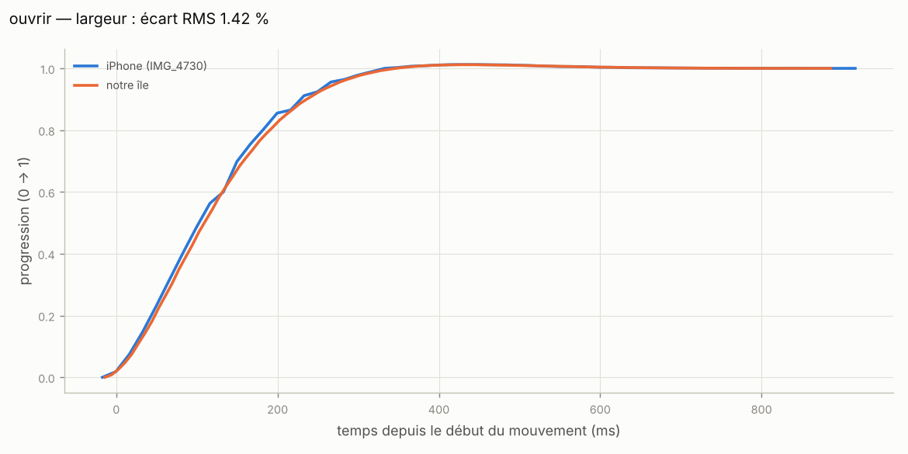
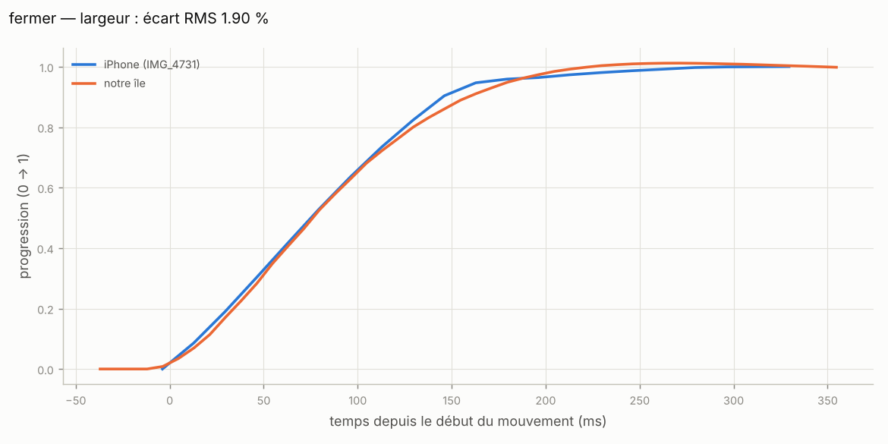
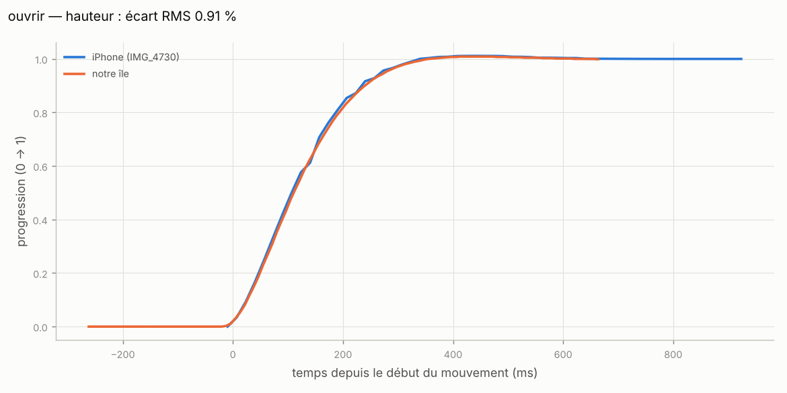
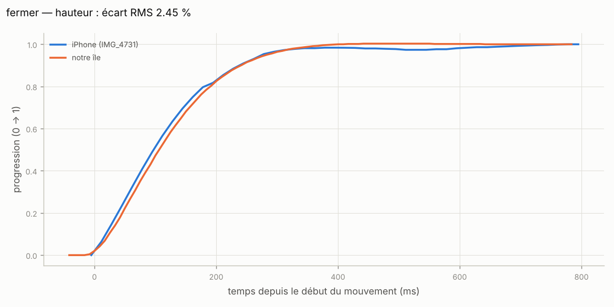
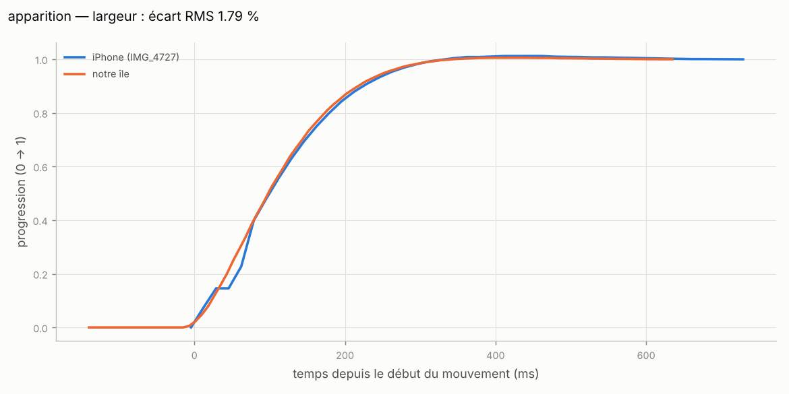
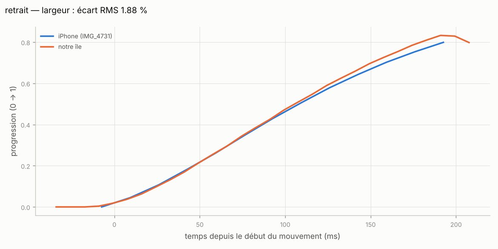
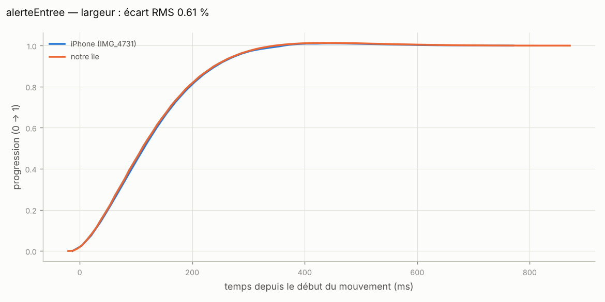
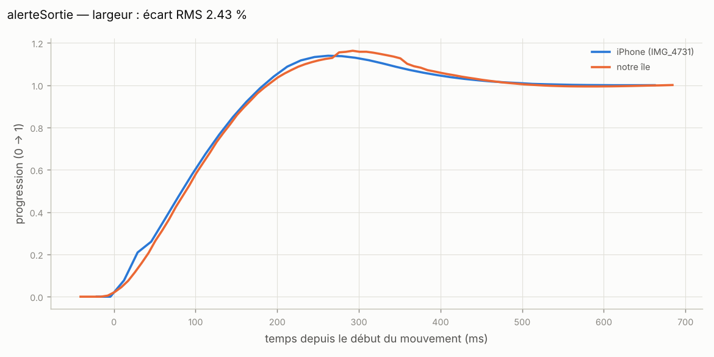
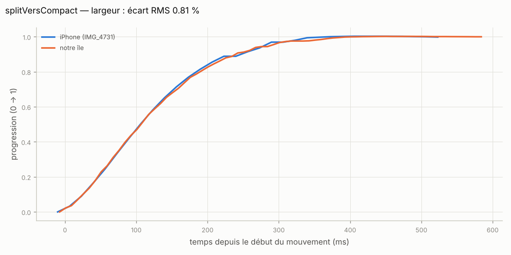
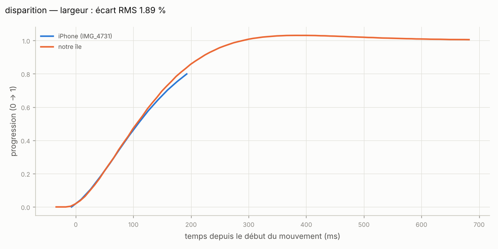

# Fidélité : notre île vs iPhone 16 Pro

Généré par `tools/valider_fidelite.py` à partir de :
- l'enregistrement de **notre île** (rendu réel React + Framer Motion dans Chromium, `tools/enregistrer_ile.cjs`, 120 images/s avec une horloge virtuelle : horodatages exacts) ;
- les **vidéos de référence** de l'iPhone (voir `docs/mesures.md`).

## Courbes (progression normalisée, alignée sur le début du mouvement)

Objectif : écart RMS < 3 %.

| Transition | Axe | Référence iPhone | Écart RMS | iPhone (response / ζ) | Notre île (response / ζ) | |
|---|---|---|---|---|---|---|
| ouvrir | largeur | IMG_4730 2.44–3.40 s | **1.42 %** | 0.520 s / 0.818 | 0.523 s / 0.816 | ✅ |
| fermer | largeur | IMG_4731 3.39–3.74 s | **1.90 %** | 0.357 s / 0.742 | 0.372 s / 0.750 | ✅ |
| ouvrir | hauteur | IMG_4730 2.44–3.40 s | **0.91 %** | 0.524 s / 0.816 | 0.528 s / 0.814 | ✅ |
| fermer | hauteur | IMG_4731 3.39–4.20 s | **2.45 %** | 0.470 s / 0.887 | 0.495 s / 0.868 | ✅ |
| apparition | largeur | IMG_4727 5.84–6.60 s | **1.79 %** | 0.459 s / 0.847 | 0.461 s / 0.845 | ✅ |
| retrait | largeur | IMG_4731 10.60–10.81 s | **1.88 %** | 0.528 s / 0.758 | 0.518 s / 0.020 | ✅ |
| alerteEntree | largeur | IMG_4731 10.80–11.60 s | **0.61 %** | 0.536 s / 0.810 | 0.537 s / 0.809 | ✅ |
| alerteSortie | largeur | IMG_4731 13.60–14.30 s | **2.43 %** | 0.495 s / 0.562 | 0.514 s / 0.540 | ✅ |
| splitVersCompact | largeur | IMG_4731 5.14–5.70 s | **0.81 %** | 0.477 s / 0.868 | 0.467 s / 0.899 | ✅ |
| disparition | largeur | IMG_4731 10.60–10.81 s | **1.89 %** | 0.528 s / 0.758 | 0.531 s / 0.758 | ✅ |

## Tailles des états stables (pt)

| État | Notre île (l × h) | iPhone (l × h) |
|---|---|---|
| compact (2 côtés) | 197.02 × 36.75 | — |
| étendu | 374.47 × 204.98 | 374.24 × 204.71 |
| alerte | 339.72 × 36.75 | 340.16 × 36.81 |
| repos | 125.12 × 36.75 | 125.48 × 36.81 |

## Délais du contenu (ouverture)

Une image iPhone = 16.7 ms. Objectif : ±1 image.

| Seuil | Notre île | iPhone | Écart (images) |
|---|---|---|---|
| 3 % | 64 ms | 62 ms | +0.15 |
| 50 % | 192 ms | 178 ms | +0.89 |
| 90 % | 280 ms | 293 ms | -0.76 |

## Graphiques












## Refaire la mesure

```bash
npx vite --port 1420
```

```bash
node tools/enregistrer_ile.cjs
```

```bash
python tools/valider_fidelite.py
```

Pour comparer un enregistrement d'écran **Windows** de l'île (ex. avec la Xbox Game Bar) :

```bash
python tools/analyze_video.py --compare tools/input/IMG_4730.MP4 ma_capture.mp4 --echelle-a 1.6517 --echelle-b 2
```

(`--echelle-b` = échelle Windows × ISLAND_SCALE, ex. 200 % × 1,0 = 2.)
